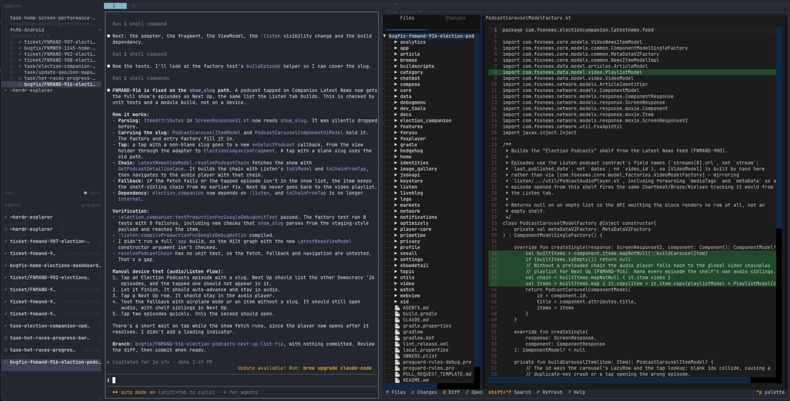
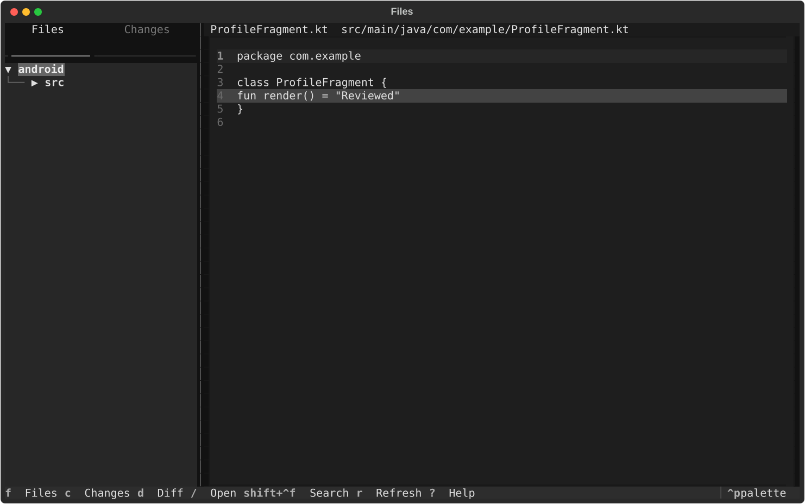
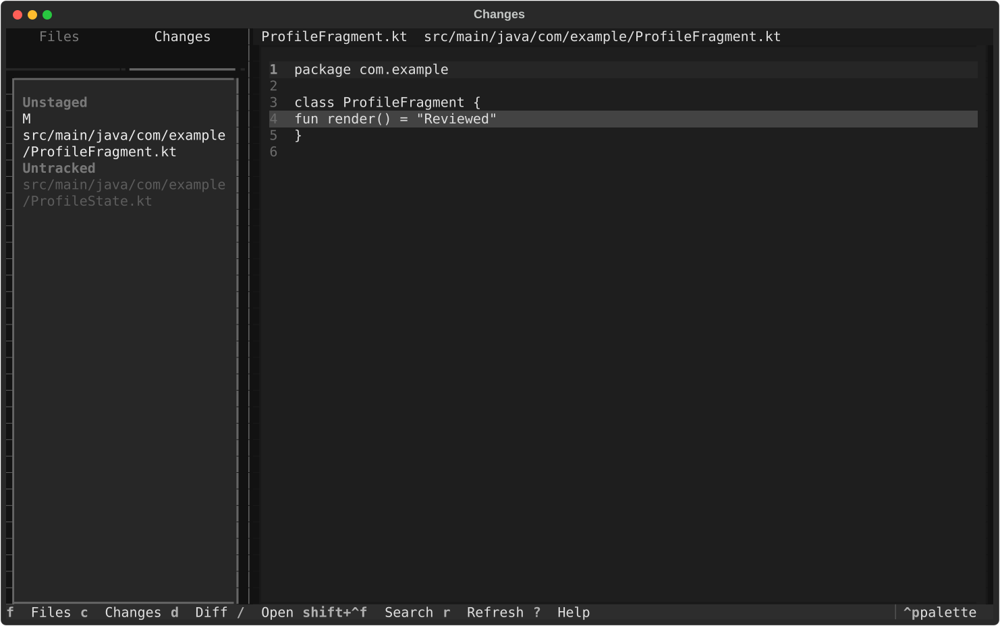
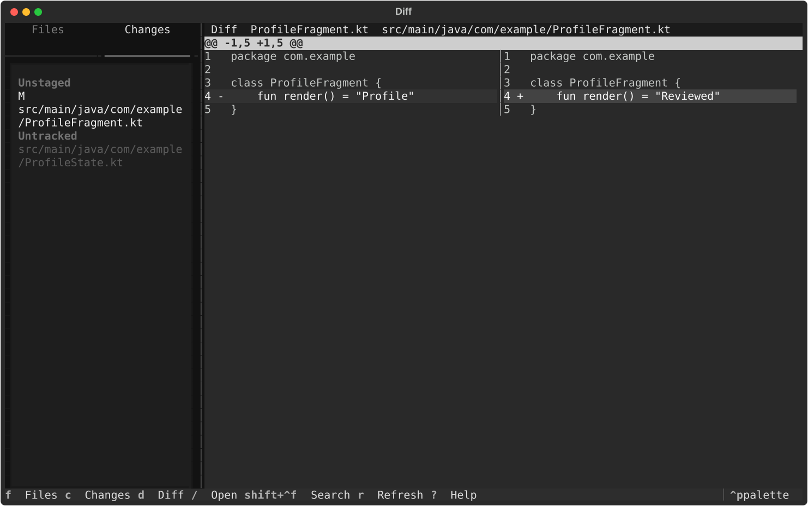

# File Explorer

A read-only [Herdr](https://herdr.dev) plugin for browsing a project and reviewing Git changes while an agent such as Codex or Claude Code edits the code. It does not replace Android Studio, and it never writes source files or changes Git state.



Android Studio, the Android SDK, Gradle, and Java are not required.

## Requirements

- Herdr 0.7.0 or newer
- Python 3.11 or newer
- Git

[Ghostty](https://ghostty.org) is recommended. A sideways trackpad swipe scrolls the file when the terminal sends horizontal scroll events, which Ghostty does. In Apple Terminal, use `h` and `l`, Shift plus a vertical swipe, or click and drag.

ripgrep is recommended for Search in Files. Without it, the plugin searches with Python.

## Version

File Explorer uses [semantic versioning](https://semver.org). Anything below `1.0.0` is a beta.

| Change | Version |
| --- | --- |
| A fix that behaves the same for existing users | `0.1.2`, `0.1.3`, … |
| New behavior, including a change to a shortcut or workflow | `0.2.0`, `0.3.0`, … |
| First release that is no longer a beta | `1.0.0` |

The current beta is `0.1.1`. The pane title shows it, and it is the first line of the shortcut help (`?`). `herdr plugin list --json` includes the same number.

## Installation

```bash
herdr plugin install andrewz-fox/herdr-explorer
```

Herdr runs `scripts/install.sh` during install. That creates a virtualenv inside the plugin checkout and installs the Python dependencies there. You do not need to clone the repository or run pip yourself.

Open the explorer beside the current pane:

```bash
herdr plugin pane open --plugin herdr-explorer --entrypoint explorer
```

Install does not add a keyboard shortcut. Herdr keeps shortcuts in your own config, so add this to `~/.config/herdr/config.toml` on Linux and macOS, or `%APPDATA%\herdr\config.toml` on Windows:

```toml
[[keys.command]]
key = "prefix+e"
type = "shell"
command = "herdr plugin pane open --plugin herdr-explorer --entrypoint explorer"
description = "open File Explorer"
```

The default prefix is `ctrl+b`, so the shortcut is `ctrl+b` then `e`. Choose another key if you already use `prefix+e`. Reload Herdr after saving the file:

```bash
herdr server reload-config
```

The shortcut then appears in Herdr's shortcut list (`ctrl+b` then `?`) as "open File Explorer".

## Uninstall

Close the File Explorer pane first. An open pane keeps running until that process exits.

For a plugin installed from GitHub:

```bash
herdr plugin uninstall herdr-explorer
```

`andrewz-fox/herdr-explorer` works in place of the plugin id. Herdr unregisters the plugin and deletes its managed copy after the Herdr server that was using it has exited.

For a plugin linked from a local checkout:

```bash
herdr plugin unlink herdr-explorer
```

Unlink removes it from Herdr and leaves the checkout on disk. Herdr keeps the plugin config directory either way.

Uninstall does not remove the `prefix+e` shortcut. Delete that `[[keys.command]]` block from your Herdr config and run `herdr server reload-config`.

## Development

Tests, screenshots, and the local bootstrap script live in `dev/`. Installing or opening the plugin does not use that directory.

`herdr plugin link` does not run install-time build commands, so install the local virtualenv first:

```bash
dev/bootstrap.sh
herdr plugin link /path/to/herdr-explorer
herdr plugin pane open --plugin herdr-explorer --entrypoint explorer
```

Run the tests with the virtualenv:

```bash
.venv/bin/python -m pytest
```

## Usage

The plugin is one Herdr pane. The left column lists files and Git changes. The right column shows the selected file or a side-by-side diff.

1. Start Herdr in the Android project, or in any Git checkout.
2. Let the coding agent edit files.
3. Open File Explorer.
4. Use Changes to review what the agent touched, then press `d` for the diff. Changed lines stay highlighted in the file when the diff is closed.
5. Keep prompting the agent. The explorer refreshes when files change.

Herdr starts the plugin in the plugin directory. File Explorer asks Herdr for the workspace worktree, then the workspace checkout, then a pane working directory. Outside Herdr, pass a path or start it from the project:

```bash
python -m herdr_explorer /path/to/project
```

## Keyboard shortcuts

| Key | Action |
| --- | --- |
| `f` | Focus Files |
| `c` | Focus Changes |
| `d` | Toggle the side-by-side diff |
| `/` | Quick open |
| `ctrl+shift+f` | Search in files |
| `n` | Next hunk |
| `p` | Previous hunk |
| `h` / `l` | Scroll left / right |
| shift + swipe up/down | Scroll sideways with the trackpad or mouse wheel |
| click and drag | Slide a file or diff sideways |
| `b` | Toggle the sidebar |
| `r` | Refresh |
| `enter` | Expand a folder, or open a file |
| `space` | Collapse or expand a folder |
| `?` | Shortcut help |
| `escape` | Close a dialog |

## Screenshots







## Known limitations

- The viewer is read-only. There is no editor, Compose preview, Logcat, Gradle runner, debugger, or symbol index.
- Highlighting covers Java, XML, JSON, YAML, and Markdown. Kotlin, Gradle, and Properties files open as plain text.
- Hidden files and generated directories (`build`, `.gradle`, `.idea`, `generated`, and similar) are not shown.
- macOS and Linux only.
- Search in Files is faster when `rg` is on `PATH`.
- `ctrl+shift+f` depends on the terminal passing that chord through to Herdr.
